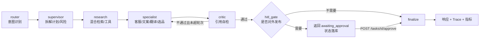

# CrossMind

> 跨境电商多智能体运营平台 · 客服 / 文案 / 翻译 / 选品 四模块一站式交付
> Python 3.11+ · FastAPI · LangGraph · 混合检索 RAG · HITL 审批 · 全链路可观测

**克隆下来就能跑，不需要任何 API Key**：默认使用离线确定性模型，真实模型只是一个环境变量开关。

```bash
pip install -r requirements.txt && pip install -e .
python -m uvicorn crossmind.api.app:app --port 8000
# 打开 http://127.0.0.1:8000/console/  （API Key 默认 demo-key-alpha）
```

| 维度 | 实测（本机离线模式，2026-11） |
|---|---|
| 自动化测试 | **95 passed**（单元 + HTTP 集成），0 skipped |
| 检索质量 | hit@5 **1.0000** · MRR **1.0000**（26 条评测集） |
| 拒答正确率 | **0.9231**（可答 20/20 不误拒；不可答 4/6 正确拒答） |
| 引用与忠实度 | 引用准确率 **1.0000** · 忠实度 **0.9971** · 要点覆盖 **0.85** |
| 单请求延迟 | p50 **8.9 ms**（离线，单并发） |
| 并发吞吐 | 300 请求 / 20 并发：**116.7 rps**，p50 **164 ms**，p95 **213 ms**，错误 **0** |
| 代码规模 | Python 5.6k 行（72 文件） + 前端 673 行 |

> 离线数字描述的是**流水线**（检索、引用回填、拒答、编排、序列化），不是大模型能力。
> 切换 `XM_LLM_PROVIDER=openai` 后需重新跑评测，口径与局限见 [docs/EVALUATION.md](docs/EVALUATION.md)。

---

## 一、它解决什么问题

跨境卖家的日常运营有四件重复且高风险的活：回客服、写文案、做本地化、选品。四件事共用同一份商品与政策知识，但需要的产出形态完全不同。CrossMind 把它们收进一个平台：

| 模块 | 用户输入 | 系统产出 | 关键约束 |
|---|---|---|---|
| 智能客服 | "未拆封多久能退货？" | 带 `【n】` 引用的答复 | 必须可溯源；无依据必须拒答转人工 |
| 文案生成 | "给 AirSound 写 Amazon 标题+五点" | 标题 + 五点描述 | 对外发布，需人工确认（HITL） |
| 翻译本地化 | "把 PowerGo 描述译成英文" | 目标语言文本 | 术语表统一、保留型号与数字 |
| 选品分析 | "音频品类值得做吗？" | 市场 / 竞品 / 建议三段报告 | 对外决策，需人工确认（HITL） |

一个请求的完整生命周期：



## 二、六个值得看的设计

**1. 引用由系统回填，不让模型写来源。**
模型只被允许输出 `【1】` 这样的编号，`doc_id / 标题 / 小节 / 分数` 全部从检索结果回填；编号越界会被剔除并写进 `warnings`。
"可溯源"于是成为**可校验的性质**，而不是提示词里的请求。实现见 [citation.py](src/crossmind/rag/citation.py)。

**2. 拒答前置，且拒绝"无引用的答案"。**
检索分数低于阈值 → 不调用模型直接拒答（省钱且断掉幻觉路径）；模型给了答案却没有任何引用 → 判定不可验证，同样拒答。
外加一层**可答性门禁**：问题里的实体（如"以旧换新""门店"）在检索证据里从未出现时，无论模型多能编都拒答。实现见 [pipeline.py](src/crossmind/rag/pipeline.py)、[answerability.py](src/crossmind/rag/answerability.py)。

**3. 阈值是标定出来的，不是拍脑袋。**
先用 `scripts/calibrate.py` 打出 26 条评测集的分数分布，看到"可答组最低 vs 不可答组最高"存在重叠，才决定需要用可答性门禁兜底，并把阈值定在 0.18 / 0.30。过程与数据见 [docs/EVALUATION.md](docs/EVALUATION.md)。

**4. HITL 用两阶段状态机，不用阻塞中断。**
需要人工确认的任务在 `awaiting_approval` 处**落库并返回**，审批时从快照继续 `finalize`。进程重启不丢任务，审批可审计，且这条路径能被单测覆盖（`test_approval_resumes_task`）。

**5. 降级是显式的，不是静默的。**
远程模型失败 → 重试 → 熔断器打开 → 回退到离线模型，并在指标 `crossmind_llm_calls_total{status="degraded"}` 与日志里留痕；Embedding 不可用时检索退化为纯 BM25 并标记 `degraded`。

**6. 每条请求都有 trace。**
`trace_id` 贯穿日志、响应头、Trace 树与审计表；`span` 覆盖鉴权、检索、生成、各个 Agent 节点。控制台"运维观测"页可直接看到节点耗时。

## 三、API

服务启动后打开 `/docs` 有完整 OpenAPI。核心端点：

| 方法 | 路径 | 说明 |
|---|---|---|
| POST | `/api/v1/chat` | 同步对话，返回答案 + 引用 + 步骤 + trace_id |
| POST | `/api/v1/chat/stream` | SSE 流式：`step` / `delta` / `done` 三类事件 |
| GET | `/api/v1/tasks` | 任务列表（按租户隔离） |
| POST | `/api/v1/tasks/{id}/approve` | 人工审批：`approve` / `reject` |
| GET | `/api/v1/kb/search?q=` | 混合检索（不经生成，便于排查召回） |
| POST | `/api/v1/kb/answer` | 带引用与拒答的问答 |
| POST | `/api/v1/eval/run` | 重跑评测并落 `reports/` |
| GET | `/api/v1/ops/traces` | 最近链路 Trace |
| GET | `/metrics` | Prometheus 文本指标 |
| GET | `/healthz` `/readyz` | 存活 / 就绪探针 |

统一错误信封（任何失败都是同一种结构，调用方不用解析自然语言）：

```json
{"error": {"code": "rate_limited", "message": "rate limit exceeded",
           "details": {"scope": "chat", "retry_after_s": 0.8},
           "retryable": true, "trace_id": "a1b2c3d4e5f6a7b8"}}
```

## 四、工程化能力清单

| 能力 | 实现位置 | 行为 |
|---|---|---|
| API Key → 租户 | `security/auth.py` | 常量时间比较，租户级数据隔离 |
| 限流 | `security/ratelimit.py` | 令牌桶，按租户 + 路由划分预算，429 带 `Retry-After` |
| 幂等 | `storage/db.py` + `/chat` | `Idempotency-Key` 重放同一响应，不重复计费 |
| 输入防护 | `security/guard.py` | 提示注入拦截、卡号/手机号/邮箱脱敏后入日志 |
| 配置校验 | `config.py` | 启动即校验（阈值范围、密钥格式、日志级别） |
| 契约校验 | `domain/models.py` | pydantic 严格模型，`extra="forbid"` 防字段漂移 |
| 可观测 | `obs/*` | JSON 日志 + Trace + Prometheus 指标 |
| 审计 | `storage/db.py` | 审批、评测、拦截等动作留痕 |
| 测试 | `tests/` | 95 条，覆盖检索、引用、门禁、编排、HTTP 契约 |
| 交付 | `Dockerfile` / `compose` / CI | 非 root 运行、健康检查、GitHub Actions 质量门禁 |

## 五、目录结构

```
crossmind/
├── src/crossmind/
│   ├── config.py            # 12 组配置项，启动即校验
│   ├── container.py         # 组合根：依赖显式注入，无全局单例
│   ├── domain/              # 枚举 / 模型 / 错误码
│   ├── obs/                 # 日志 / Trace / Prometheus 指标
│   ├── llm/                 # 模型抽象 + 离线夹具 + OpenAI 兼容 + 熔断降级
│   ├── embedding/           # 特征哈希向量（离线）+ 远程 embedding
│   ├── rag/                 # 分块 / BM25 / 混合索引 / 重排 / 引用 / 门禁 / 评测
│   ├── agents/              # LangGraph 编排：节点、状态、工具、记忆
│   ├── services/            # 对话服务、任务审批、商品目录
│   ├── security/            # 鉴权、限流、输入防护
│   ├── storage/             # SQLite：任务/幂等/记忆/审计
│   └── api/                 # 路由、依赖、中间件、错误处理
├── apps/web/                # 零构建 Vue-less 控制台（原生 JS + SSE）
├── data/                    # 12 篇语料 + 26 条评测集 + 商品目录
├── tests/                   # 95 条测试
├── scripts/                 # 标定 / 评测 / 压测 / Windows 脚本
├── docs/                    # 架构、评测、运维、ADR、简历材料
└── reports/                 # 评测与压测产物（可复现）
```

## 六、命令

```bash
make install    # 安装依赖
make run        # 启动服务（/console/）
make test       # 95 条测试
make eval       # 离线评测 -> reports/rag-eval.{json,md}
make load       # 300 请求 / 20 并发压测 -> reports/load-test.json
make smoke      # 冒烟：能答的答、该拒的拒
```

Windows 用 `pwsh -File scripts/dev.ps1 test`（等价命令）。

## 七、配置

所有配置以 `XM_` 前缀的环境变量提供，完整清单见 [.env.example](.env.example)。常用的几个：

| 变量 | 默认 | 说明 |
|---|---|---|
| `XM_LLM_PROVIDER` | `mock` | `mock` 离线可跑；`openai` 接任意 OpenAI 兼容网关 |
| `XM_LLM_API_KEY` / `XM_LLM_BASE_URL` / `XM_LLM_MODEL` | 空 | 仅在线模式需要 |
| `XM_API_KEYS` | 两个演示 key | 格式 `key:tenant,key:tenant` |
| `XM_RATE_LIMIT_RPS` | `20` | 每租户每秒令牌数 |
| `XM_RAG_SCORE_THRESHOLD` | `0.18` | 低于此分直接拒答 |
| `XM_RAG_ANSWERABILITY_THRESHOLD` | `0.30` | 证据覆盖率低于此值拒答 |
| `XM_HITL_AMOUNT_THRESHOLD` | `500` | 高风险金额阈值 |

## 八、已知边界（诚实清单）

- 离线模型的翻译是**术语表替换的确定性玩具**，只用于打通链路，不代表翻译质量；真实质量需接在线模型后重测。
- 可答性门禁是词面覆盖代理，两条例题（"加拿大清关""加密货币付款"）仍会误答，已定位并在评测报告里单列。
- 并发压测下 p95 约 210 ms、吞吐约 117 rps：瓶颈是单进程 SQLite 同步写与单事件循环，扩容路径见 [docs/ARCHITECTURE.md](docs/ARCHITECTURE.md) 的演进章节。
- 会话记忆只做最近 12 轮窗口，长期偏好记忆在 Roadmap 中。

## 九、Roadmap

1. 检索：接真 reranker（bge-reranker / gte-rerank），用真实模型重跑评测建立基线。
2. 门禁：把词面覆盖换成 NLI / LLM judge，消灭 near-miss 误答。
3. 存储：SQLite → Postgres，任务/审计/记忆拆表；限流迁到 Redis。
4. 编排：把 HITL 换成 LangGraph `interrupt` + checkpointer，支持多步审批。
5. 交付：K8s Helm chart、灰度发布、链路数据接 OpenTelemetry。

---

本项目为个人作品（非商业产品），语料与商品数据为虚构示例。许可证见 [LICENSE](LICENSE)。

