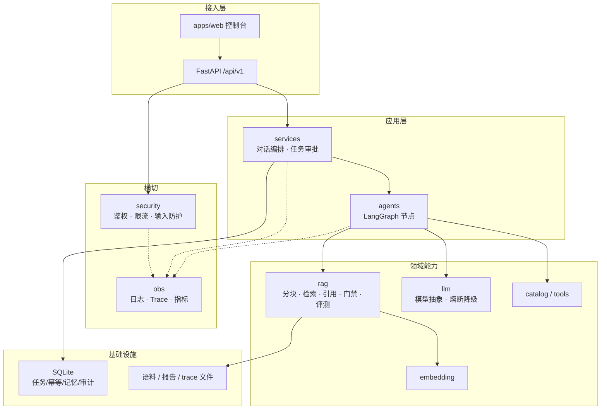
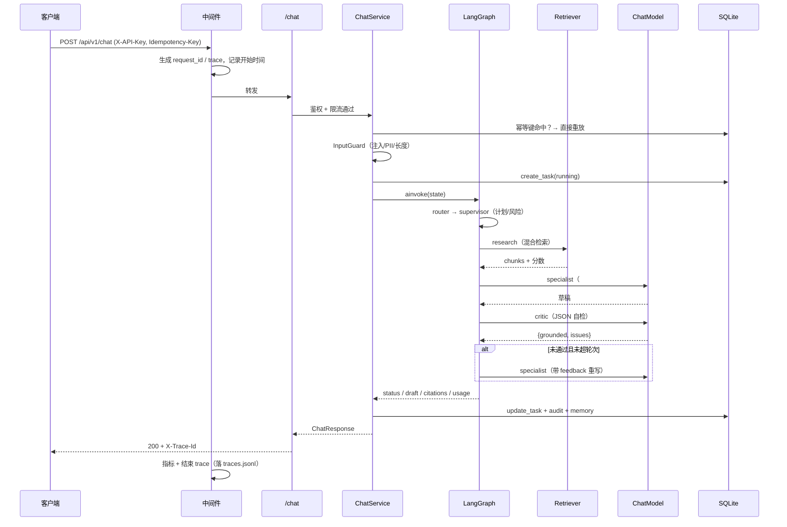

# 架构说明

## 1. 目标与约束

| 目标 | 约束 |
|---|---|
| 一个请求走完四模块的业务闭环 | 单仓、可单机启动 |
| 任何拿到代码的人都能跑起来 | 默认零密钥、零外部服务 |
| 回答必须可溯源、不可编造 | 引用回填 + 双重拒答 |
| 对外发布的内容必须有人负责 | HITL 审批状态机 |
| 出问题能定位 | trace / 指标 / 审计 三件套 |

非目标（v1.0 明确不做）：多副本水平扩展、向量库独立部署、真实支付/物流对接。

## 2. 分层



依赖方向单向向下：`api → services → agents → rag/llm → domain`。`container.py` 是唯一的组合根，测试里可以注入替身容器，不需要猴子补丁。

## 3. 一次对话的时序



关键点：**拒答发生在调用模型之前**（retrieval 或 gate 任一判定无依据），因此拒答路径没有 token 成本，也没有幻觉窗口。

## 4. 模块职责

| 模块 | 负责 | 不负责 |
|---|---|---|
| `api/` | 协议、鉴权依赖、路由、错误信封、中间件 | 业务判断 |
| `services/` | 一次请求的副作用：任务落库、幂等、审计、记忆 | 推理细节 |
| `agents/` | 意图路由、计划、工具调用、自检、HITL 决策 | 持久化 |
| `rag/` | 分块、索引、检索、重排、引用、门禁、评测 | 对话状态 |
| `llm/` | 模型抽象、重试、熔断、降级、token 统计 | 提示词业务语义 |
| `security/` | 认证、限流、注入与 PII 防护 | 业务授权模型 |
| `obs/` | 结构化日志、trace 树、指标注册表 | 业务埋点语义 |
| `storage/` | 显式 SQL 的仓储层 | 业务规则 |

## 5. 数据模型

```sql
tasks(id PK, tenant_id, type, status, risk, input JSON, output JSON, trace_id, error, created_at, updated_at)
approvals(task_id PK, decision, reviewer, comment, created_at)
idempotency(key PK, tenant_id, response JSON, created_at)
memory(id PK, tenant_id, session_id, role, content, created_at)
audit(id PK, tenant_id, action, resource, detail, trace_id, created_at)
```

- `tasks.output` 在待审批时存入**完整图状态快照**，审批时据此恢复，不重跑昂贵节点。
- `memory` 只做最近窗口（默认 12 轮），避免无限增长。
- `idempotency` 按 `(key, tenant)` 隔离，跨租户不可重放。

## 6. 可观测性

| 信号 | 载体 | 用途 |
|---|---|---|
| 日志 | 单行 JSON，含 `trace_id` / `tenant_id` / `request_id` | 与 trace 关联排查 |
| Trace | 内存环形缓冲（512）+ `var/traces/traces.jsonl` | 节点级耗时，控制台可看 |
| 指标 | `/metrics` Prometheus 文本 | HTTP 延迟、LLM 调用/降级、检索结果、限流、HITL、幂等重放 |
| 审计 | `audit` 表 | 审批、评测、拦截等合规证据 |

## 7. 性能与扩展边界（实测）

| 场景 | 结果 | 解读 |
|---|---|---|
| 单请求（离线） | p50 8.9 ms | 检索 1.9 ms + 图 6.0 ms + 序列化 |
| 300 请求 / 20 并发 | 116.7 rps，p95 213 ms | 单进程、事件循环内同步 SQLite 写 |
| 评测 26 条 | 平均 2.6 ms/条 | 全离线，无网络 |

瓶颈定位：并发下延迟抬升来自 `/chat` 的 5 次 SQLite 提交与单事件循环争用，而不是检索。
扩容路径（按性价比排序）：

1. 写路径异步化：任务/审计/记忆合并为一次提交或走队列（预计 3-5×）。
2. SQLite → Postgres（多副本前提）。
3. 限流与幂等迁到 Redis（多实例共享状态）。
4. 只为“读”加缓存：相同问题 + 相同 KB 版本的答案缓存（需带版本键，避免语料更新后命中旧答案）。

## 8. 扩展点

| 想换 | 改哪里 | 不用动 |
|---|---|---|
| 换真实模型 | `XM_LLM_PROVIDER=openai` + 三个变量 | 业务代码 |
| 换向量库 | 实现 `HybridIndex` 同名接口 | 检索/引用/评测 |
| 换 reranker | 替换 `HeuristicReranker.rerank` | 图与 API |
| 换可答性判定 | 替换 `AnswerabilityGate.evaluate` | 流水线 |
| 加工具 | `ToolRegistry._build` 增加 `ToolSpec` | 节点逻辑 |
| 换存储 | 重写 `Store`（同方法签名） | 服务层 |

## 9. 测试策略

| 层 | 方式 | 例子 |
|---|---|---|
| 纯逻辑 | 直接调用 | 分块尺寸、BM25 饱和、引用越界剔除 |
| 组件 | 真实索引 + 离线模型 | 检索命中、门禁、流水线引用 |
| 编排 | `graph.ainvoke` | 意图路由、HITL 暂停/恢复、轮次上限 |
| HTTP | ASGITransport 全链路 | 401/422/409、幂等、租户隔离、SSE |
| 质量 | 评测脚本 | hit@k / MRR / 拒答 / 忠实度 |

共 95 条，全部离线可复现。

